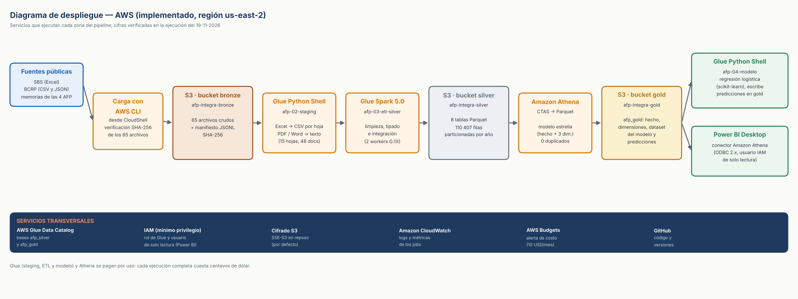

# Big Data - Sistema Privado de Pensiones (AFP)

Proyecto académico de análisis de datos del Sistema Privado de Pensiones del Perú.

# Docente

- Caballero Alvarado, Armando

# Participantes

- Infantes Rondo, Junior
- Reyes Figueroa, Brandon
- Salvador Mauricio, Angel
- Terrones Llamo, Jan

Predicción del bajo rendimiento relativo de AFP Integra (Fondo 2) frente al promedio de Habitat,
Prima y Profuturo, con datos públicos de la SBS, el BCRP y las memorias anuales de las 4 AFP.

El repositorio tiene dos versiones del mismo pipeline:

| Versión | Dónde | Carpeta |
|---|---|---|
| On-premise (hito parcial) | Hadoop 3.3.6 + Spark 3.5.1 + Hive, JupyterLab | `src/`, `notebooks/`, `analisis/` |
| Nube (hito final) | AWS, región `us-east-2` (Ohio) | `cloud/` |

## Arquitectura en AWS (medallion: bronze → silver → gold)



| Zona / etapa | Servicio | Recurso | Script |
|---|---|---|---|
| Bronze | Amazon S3 | `afp-integra-bronze-672469410615` | `cloud/01_bronze/build_bronze.py` |
| Preparación | AWS Glue Python Shell | job `afp-02-staging` | `cloud/02_staging/afp_staging_job.py` |
| Silver | AWS Glue Spark 5.0 + Glue Data Catalog | job `afp-03-etl-silver`, base `afp_silver` | `cloud/03_silver/afp_etl_silver_job.py` |
| Gold | Amazon Athena (CTAS a Parquet) | base `afp_gold`, bucket `afp-integra-gold-672469410615` | `cloud/04_gold/afp_gold_athena.sh` |
| Dataset del modelo | Amazon Athena | `afp_gold.dataset_modelo_mensual` | `cloud/04_gold/afp_gold_dataset_modelo.sh` |
| Modelo | AWS Glue Python Shell | job `afp-04-modelo` | `cloud/05_modelo/afp_modelo_job.py` |
| Consumo BI | Amazon Athena | `afp_gold.v_rendimiento`, `afp_gold.predicciones_modelo` | `cloud/04_gold/afp_gold_vistas_dashboard.sh` |
| Dashboard | Power BI Desktop + driver ODBC 2.x de Athena | `dashboard/dashboard_afp_integra.pbix` | — |

Seguridad: rol `AWSGlueServiceRole-afp` (solo los 3 buckets del proyecto), usuario `powerbi-athena`
de solo lectura sobre gold, cifrado SSE-S3 y bloqueo de acceso público en los buckets, alerta de
presupuesto de 10 USD/mes. Políticas en `cloud/iam/`.

## Reproducir el despliegue

Todo se ejecuta desde **AWS CloudShell** (región `us-east-2`).

```bash
export AWS_PAGER=""
ACC=672469410615
```

### 0. Rol de Glue
```bash
aws iam create-role --role-name AWSGlueServiceRole-afp \
  --assume-role-policy-document file://cloud/iam/glue_role_trust_policy.json
aws iam attach-role-policy --role-name AWSGlueServiceRole-afp \
  --policy-arn arn:aws:iam::aws:policy/service-role/AWSGlueServiceRole
aws iam put-role-policy --role-name AWSGlueServiceRole-afp --policy-name afp-s3-buckets \
  --policy-document file://cloud/iam/glue_role_s3_policy.json
```

### 1. Bronze
Se arma la estructura `familia/conjunto/ingest_date=AAAA-MM-DD/archivo` con el manifiesto SHA-256
(mismo criterio que el cuaderno 01) y se sube a S3:
```bash
python3 -I cloud/01_bronze/build_bronze.py <carpeta_fuentes> bronze 2026-11-19
aws s3 sync bronze/ s3://afp-integra-bronze-$ACC/
```
Resultado esperado: 65 archivos verificados + 1 manifiesto (`_manifests/01_manifiesto_ingesta_2026-11-19.jsonl`).

### 2. Preparación (Glue Python Shell)
```bash
aws s3 cp cloud/02_staging/afp_staging_job.py s3://afp-integra-silver-$ACC/scripts/
aws glue create-job --name afp-02-staging --role AWSGlueServiceRole-afp \
  --command Name=pythonshell,PythonVersion=3.9,ScriptLocation=s3://afp-integra-silver-$ACC/scripts/afp_staging_job.py \
  --max-capacity 1 --timeout 30 \
  --default-arguments '{"--BRONZE":"afp-integra-bronze-'$ACC'","--SILVER":"afp-integra-silver-'$ACC'","--additional-python-modules":"xlrd==2.0.1,openpyxl==3.1.5,pypdf==5.9.0,olefile==0.47","library-set":"analytics"}'
aws glue start-job-run --job-name afp-02-staging
```
Resultado esperado: 3 libros, 15 hojas, 48 documentos, 0 errores (`staging/_registro/03_staging_registro.json`).

### 3. Silver (Glue Spark)
```bash
aws s3 cp cloud/03_silver/afp_etl_silver_job.py s3://afp-integra-silver-$ACC/scripts/
aws glue create-job --name afp-03-etl-silver --role AWSGlueServiceRole-afp \
  --glue-version 5.0 --worker-type G.1X --number-of-workers 2 --timeout 30 \
  --command Name=glueetl,PythonVersion=3,ScriptLocation=s3://afp-integra-silver-$ACC/scripts/afp_etl_silver_job.py \
  --default-arguments '{"--BRONZE":"afp-integra-bronze-'$ACC'","--SILVER":"afp-integra-silver-'$ACC'","--DATABASE":"afp_silver","--enable-glue-datacatalog":"true","--enable-metrics":"true","--enable-continuous-cloudwatch-log":"true","--additional-python-modules":"xlrd==2.0.1,openpyxl==3.1.5"}'
aws glue start-job-run --job-name afp-03-etl-silver
```
Resultado esperado: 8 tablas en `afp_silver`, 110 407 filas en total, 0 duplicados de clave.

| Tabla | Filas |
|---|---|
| bcrp_series_largas | 12 317 |
| bcrp_json_rentabilidad | 699 |
| sbs_afiliados | 1 148 |
| sbs_rentabilidad | 2 898 |
| sbs_valor_cuota | 76 059 |
| memorias_indicadores | 48 |
| tabla_analitica_mensual | 140 |
| sbs_indicadores_adicionales | 17 098 |

### 4. Gold (Athena)
```bash
bash cloud/04_gold/afp_gold_athena.sh
bash cloud/04_gold/afp_gold_dataset_modelo.sh
```
Resultado esperado:
- `hecho_rendimiento_mensual`: 2 484 filas (rent_real_12m 700, rent_nominal_12m 680, afiliados_activos 544, valor_cuota_fin_mes_f2 560), 0 duplicados de grano.
- `dataset_modelo_mensual`: 140 meses; objetivo 0 = 67, 1 = 72, sin etiqueta = 1 (ago-2026).

### 5. Modelo (Glue Python Shell)
```bash
aws s3 cp cloud/05_modelo/afp_modelo_job.py s3://afp-integra-gold-$ACC/scripts/
aws glue create-job --name afp-04-modelo --role AWSGlueServiceRole-afp \
  --command Name=pythonshell,PythonVersion=3.9,ScriptLocation=s3://afp-integra-gold-$ACC/scripts/afp_modelo_job.py \
  --max-capacity 1 --timeout 30 \
  --default-arguments '{"--GOLD":"afp-integra-gold-'$ACC'","library-set":"analytics","--additional-python-modules":"matplotlib==3.7.5"}'
aws glue start-job-run --job-name afp-04-modelo
```
Resultados en `s3://afp-integra-gold-$ACC/modelo/` (copia en `resultados/cloud/`).

### 6. Vistas para el dashboard y conexión de Power BI
```bash
bash cloud/04_gold/afp_gold_vistas_dashboard.sh
```
Esperado: `v_rendimiento` 2 484 filas; `predicciones_modelo` 43 de prueba + 1 sin etiqueta.

Power BI Desktop: instalar el driver ODBC 2.x de Athena (Windows 64 bits), crear el DSN
`athena_afp` (región `us-east-2`, catálogo `AwsDataCatalog`, base `afp_gold`, workgroup `primary`,
salida `s3://afp-integra-gold-672469410615/_athena/`, autenticación IAM con el usuario
`powerbi-athena`) y conectar con *Obtener datos → Amazon Athena* en modo **Importar**.
Las claves de acceso nunca se suben al repositorio.

## Cambio del objetivo del modelo (respecto del hito parcial)

En el parcial la etiqueta usaba la rentabilidad real **a 12 meses móviles**: la brecha de un mes y la
del siguiente comparten 11 de 12 meses, por eso el signo se repetía en el 87,8 % de los meses y el
AUC de 0,94 venía casi todo de esa persistencia. En la nube la etiqueta usa la rentabilidad
**mensual** (variación del valor cuota de fin de mes, Fondo 2), que no comparte meses entre
periodos: la persistencia del signo baja a 49,6 %.

Resultados en prueba (ene-2023 a jul-2026, 43 meses), misma metodología del parcial
(corte cronológico, regresión logística, bootstrap de bloques):

| Modelo | AUC prueba |
|---|---|
| Clase mayoritaria | 0,500 |
| Persistencia (signo actual) | 0,463 |
| Solo inercia | 0,314 |
| Solo contexto | 0,517 |
| Modelo base (inercia + contexto) | 0,487 |

Con el objetivo corregido, ningún modelo supera al azar: no hay evidencia de que estas variables
anticipen el bajo rendimiento mensual de Integra.

## Costos
Glue (staging, ETL y modelo) y Athena se cobran por uso; cada ejecución completa del pipeline
cuesta centavos de dólar. Hay una alerta de presupuesto de 10 USD/mes.

## Versión on-premise (hito parcial)

### Arquitectura (Ruta A)

Ruta A (on-premise):

- HDFS: almacenamiento distribuido.
- Apache YARN: gestión de recursos.
- Apache Spark 3.5.1: procesamiento de datos.
- JupyterLab: desarrollo y ejecución de notebooks.
- Hive Metastore compatible: catálogo persistente con Apache Derby.
- Parquet: almacenamiento de datos procesados.

### Fuentes

- SBS: archivos Excel de afiliación, rentabilidad y valor cuota.
- BCRP: series económicas CSV y rentabilidad JSON.
- AFP: memorias anuales PDF, DOC y DOCX.
- Archivos auxiliares de revisión y control.

Los datos originales se mantienen fuera del repositorio Git.

### Organización

- `notebooks/`: notebooks de ingesta, procesamiento y verificación.
- `src/`: módulos Python del ETL.
- `inputs/drive/`: fuentes locales, no incluidas en Git.
- `evidencias/`: resultados y registros locales.
- `metastore/`: catálogo Derby local, no incluido en Git.

### Data lake

Ruta HDFS utilizada en el laboratorio:

`/user/junior/datalake_afp_v2/`

Zonas:

- `raw/`: archivos originales.
- `staging/`: archivos preparados.
- `processed/`: tablas Parquet.
- `quality/`: controles de calidad.
- `catalog/`: recursos del catálogo.

### Resultados de referencia

Siete tablas analíticas y 140 meses integrados, desde enero de 2015 hasta agosto de 2026.

Los conteos y validaciones se encuentran documentados en los notebooks.

### Reproducción

Cada integrante debe configurar sus propias rutas de HDFS, Spark y el acceso a los archivos originales.

Las rutas absolutas del laboratorio original deben adaptarse antes de ejecutar el pipeline en otra máquina.

### Colaboración

Se recomienda trabajar en ramas individuales y enviar Pull Requests a `main`.
